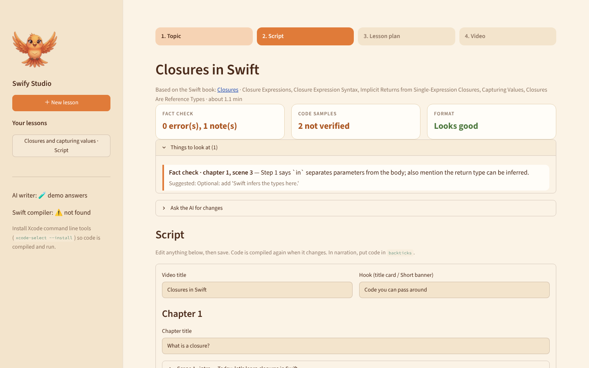

# Explainer engine

Content-first animated explainer videos with a small mascot (e.g. Swify, who explains Swift).
One lesson becomes a long YouTube video (16:9) and Shorts (9:16). Forked from `animated-history-shorts`:
the LLM client (`llm/`), sound bed (`pipeline/sound.py`) and pronunciation helpers come from there; the 3D sets
and character cards are replaced by a 2D scene kit and a mascot layer.

```
lesson.json -> code check -> narration + word timings -> timeline (cue words -> frames) -> Remotion render -> loudness + exports
```

## Swify Studio (the easy way)



```bash
streamlit run app.py        # opens http://localhost:8501 in your browser
```

1. **Topic**: type a topic, pick the level, "Long video + Shorts" or "Short only", and the Swift book chapter
   (suggested automatically). Optional: notes for the writer, extra source text.
2. **Script**: the AI writes the lesson **only from that chapter of the official Swift book**. Then, automatically:
   every code sample is compiled and run (real output replaces guesses), a second AI model fact-checks the script
   against the book, and format rules are checked (line lengths for phones, sentence endings, ...).
   You edit anything, ask the AI for changes, or let it fix the findings. Approve when it's right.
3. **Lesson plan**: the approved script becomes `lesson.json` without any AI, so the video says exactly what you approved.
4. **Video**: pick the voice and which videos to make (YouTube video, each chapter as a Short), render, watch, download.

Every lesson is saved in `lessons/<name>/draft.json`; reopen it from the sidebar at any step.

**AI key (free):** copy `llm/.env.example` to `llm/.env` and paste a key, e.g. from console.groq.com (free tier).
Any OpenAI-compatible service works; add fallbacks as LLM2_*/LLM3_*. To try the app without a key:
`SWIFY_MOCK_LLM=1 streamlit run app.py` (canned demo answers).

## Setup
Python 3.11+, Node 20+, FFmpeg, Chrome or Chromium. For Swift lessons, install the Swift toolchain (`swiftc`) so every sample is compiled and its real output shown.

```bash
python3 -m venv .venv && source .venv/bin/activate
pip install -r requirements.txt
cd studio && npm install && cd ..
# optional offline voice: put kokoro.onnx + voices.bin (github.com/thewh1teagle/kokoro-onnx releases) in models/
```

## Make a video
```bash
python pipeline/import_mascot.py channels/swify        # once per mascot: cut-out, parts, preview.jpg
python make.py lessons/swift-optionals --voice edge     # or --voice kokoro (offline)
python make.py lessons/swift-optionals --still 60,400   # quick PNG check of chosen frames
cd studio && npx remotion studio src/index.ts --props=../lessons/swift-optionals/build/props_youtube.json --public-dir=../lessons/swift-optionals/build/public   # live preview
```
Outputs land in `lessons/<slug>/out/`: `_youtube.mp4`, `_short1.mp4`, `_youtube.srt`, `_metadata.txt` (chapters).

## Writing a lesson
See `lessons/swift-optionals/lesson.json`. Scenes: `title`, `concept`, `code`, `compare`, `list`, `outro`.
Every reveal names a **cue word** from that scene's `say` text and appears exactly when it is spoken.
Mascot: `{"beat": "wave|point|nod|hop|celebrate|think|flap", "cue": "word"}` and at most one short `{"line": "..."}` per scene.
Write code in narration between backticks (`` `Int?` ``) so it is spoken correctly ("optional Int").

## Adding a mascot
Put one image in `channels/<name>/source/`, describe it in `mascot.json` (copy Swify's), run `import_mascot.py`.
With a `parts` block the wings (or arms) are cut out and animated; without it the mascot runs in card mode.

## Status
Done: scene kit, 16:9 and 9:16 layouts, Swify import with wing parts, blink, idle and reactions, speech bubbles,
AI voice (Edge, Kokoro) with word timing, cue-word timeline, code check, captions, chapters, .srt, loudness.
Swify Studio: topic -> grounded script -> compile + fact-check -> your review -> lesson.json -> video.
Next: own-voice recording path, Shorts rewrite mode, diagram scene, thumbnails.
